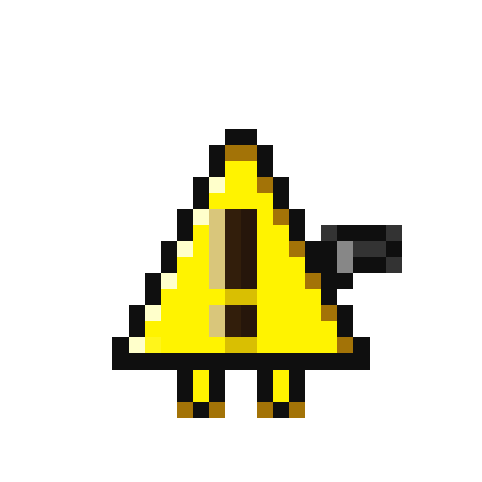

  <a>
    <picture>
      <source media="(prefers-color-scheme: dark)" srcset="docs/brand/artcraft-logo-white.svg">
      
    </picture>
  </a>

<h1 align="center">Boshy GMS2 Port</h1>

  The GameMaker LTS 2026 port of “I Wanna Be The Boshy”.

> [!IMPORTANT]
> This project is still under development and may contain many bugs or behavior that differs from the original game. If you encounter any issues, please report them via the [issues page](https://github.com/cubeww/boshy-gms2/issues).

## Supported Platforms
All platforms supported by GameMaker LTS 2026.

## Progress
All game content except for the online features has been ported.

## About the Port
This is **NOT** a remake; the focus is on faithfully recreating the original game’s physics and visual effects. Certain features that significantly enhance the gameplay experience can be enabled in the options, such as Auto Fire and Low Input Latency.

## License
MIT License
